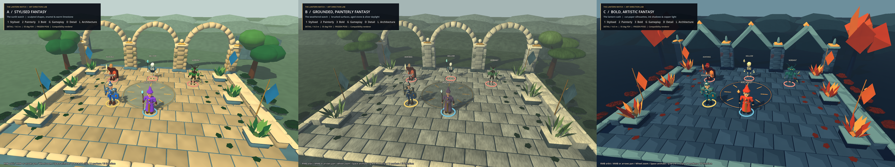

# The Lantern Watch - art-direction exploration

**Milestone 1 / decision prototype / 23 October 2026**

Three working interpretations of the same courtyard are implemented. No direction has been selected or applied to normal gameplay. The recommendation below is advice for your decision, not an approval or rollout.

## Inspect and compare

Open the existing FantasyTactics project in Godot 4.7.2, open `dev/art_direction/comparison.tscn`, and press **F6**. F5 continues to run the ordinary game.

| Control | Result |
| --- | --- |
| 1 / 2 / 3, or labelled buttons | Switch A / B / C; preserve the current camera and actor positions |
| G / D / L, or labelled buttons | Matching gameplay / detail / architecture camera presets |
| RMB drag / MMB drag / arrows / wheel | Existing tactical orbit / pan / zoom controls |
| Space | Animate or freeze the current clip |
| Q / W / E / R / T / Y | Idle / Walk / Attack / Cast / Hit / Death |
| H | Toggle labels and existing selection-ring geometry |
| F9 | Hide/show the comparison interface |

The lab reuses TacticalCamera, CharacterVisual, the original six clips, original courtyard rubble/ivy/moss/fern/shrub/wall meshes, and the shipped selection-ring mesh. It adds a small, hand-composed courtyard section and local material/geometry variants. There is no combat simulation in the lab; the surrounding game keeps its mechanics, navigation, controls, settings and progression.

### Comparison contract

Every option contains Warden and Arcanist, an Ashfang Shieldguard, a Hollow Adept and a Verdant Stalker. Actor placements, facing, poses, terrace footprint, three arcade bays, four pillars, six planters, four banners, two trees, distant hill layout and floor medallion are fixed. Round versus angular arches and different foliage construction are intentional shape-language changes to the same objects.

All three cameras use the game's **55-degree perspective FOV**. Gameplay uses **30 m distance, -1.05 rad pitch and 0.12 rad yaw**, matching the high tactical overview range used by the existing courtyard review and arena-framing system. This is an overview, not the minimum zoom. Detail uses **14.5 m / -0.48 / 0.12**; architecture uses **23 m / -0.31 / 0.34**. The corresponding camera is identical across A, B and C. Frozen Idle is sampled at 0.35 s for reproducibility.

## What the project supports

This is a small fantasy tactics game with a two-hero party, a campaign headquartered at the Lantern Watch, and Ashfang Warband, Hollow Court and Verdant Covenant enemies. Ashfang uses aggressive living troops and heavy equipment; Hollow uses bone, death masks and cold metal; Verdant uses bark, antlers and leaf armour.

The renderer is Godot 4.7.2 **Compatibility / OpenGL**, with a 1280 x 720 reference viewport and existing reviews at 1920 x 1080. The main game uses a warm directional sun, ambient fill, distance fog, opaque faceted models, local bone-attached faction geometry and MultiMesh scenery. It has no C# gameplay or external art dependency. Original characters use rigid joint weights and six short skeletal clips. Full-arena opening views are distant; camera focus/zoom is important for appreciating detail. UI uses dark navy panels, gold emphasis, outlines and settings-dependent text sizing.

The exploration stays within that technology. No renderer switch, SSAO dependency, volumetric fog, depth-of-field, bloom, outline post-process, external texture pack or new package is required. Repeated courtyard blocks are batched. The lab's local materials and character mesh copies never mutate imported resources.

## A - Stylised Fantasy / The Sunlit Watch

**Vision and tone:** welcoming adventure, craftsmanship and clear tactical toys. Rounded masonry, legible equipment and confident colour blocks make the courtyard feel like a sculpted miniature rather than a realistic ruin.

**Palette:** primary limestone `#AC9A78`, pale cut edges `#C9B794`, blue-grey recesses `#667E82`. Secondary leaf green `#3C704B`, lighter foliage `#799A5B`, timber `#694C39`, brass `#CBA45B`, watch blue `#286CB0` and Arcanist purple `#8C54B9`. Ambient fill `#C8DCE5`; sun `#FFF0CD`.

**Characters:** body width/depth approximately 1.07 times the existing model; heroes' head geometry 1.12 times around its bind joint; arm volume 1.05 times. Enemy head attachments also receive 1.12 scaling. Keep hands and weapons substantial, faces simple, and equipment contours clean. Added bevelled Warden pauldrons and a raised Arcanist clasp demonstrate the direction without replacing either rig.

**Materials:** broad, quiet colour areas; generous edge bevels; restrained low-frequency variation. Metal is blue-grey with a controlled highlight, brass is warm, leather dark brown, skin warm, cloth blue or purple. Avoid tiny scratches that disappear at tactical distance.

**Environment and vegetation:** softened, deep-jointed limestone blocks, round voussoir arches, squat finials, clustered broad tree crowns and thick folded leaves. Repeated courses and clear borders establish scale. Decoration stays at the perimeter, leaving the characters' ground plane relatively quiet.

**Lighting and shadows:** warm elevated sun, blue ambient fill, modest distance fog and the renderer's directional shadow filtering. Light/shade transitions are softened in the material response. This is a soft graphic treatment, not ray-traced penumbra or GI.

**Factions:** retain warm rust/hide for Ashfang, ivory/mint for Hollow, and bark/green for Verdant. Body anatomy and equipment remain the primary identifiers; colour reinforces them.

**Readability:** strong blue/purple heroes against restrained warm paving. Bone is bright enough to identify Hollow; rings remain unshaded, use their existing dimensions, and sit above the floor. Keep gold decoration sparse so the active gold ring remains useful.

**Trade-off:** the best fit for existing assets and a small team; clean forms are comparatively easy to maintain. The risk is familiarity: it needs distinctive Watch symbols and stronger representative sculpting after approval to avoid a generic low-poly appearance. Implementation complexity: **low to medium**. Expected performance cost: **low**, dominated by geometry/shadows rather than texture bandwidth.

## B - Grounded, Painterly Fantasy / The Weathered Watch

**Vision and tone:** an old defensive cloister, maintained by a small order. Restrained colour, narrower proportions, chipped joints and brushed surfaces create age and a quieter, more mature mood.

**Palette:** primary aged limestone `#95968C`, worn edge `#C0BCA7`, slate recess `#555F60`. Secondary earth `#535F50`, foliage `#526747` / `#809369`, leather/timber `#514337`, aged brass `#A58B58`, Warden cloth `#3E526C`, Arcanist cloth `#736478`. Ambient `#B5C5CE`; sun `#F6DDAD`.

**Characters:** model width/depth 0.94 and height 1.04 times the original; hero heads 0.96 around their bind joint; arm volume 0.98. Enemy head attachments use 0.94. Armour additions use restrained bevels and smaller highlight areas. Existing rigs limit how natural the anatomy can become in this prototype.

**Materials:** world-anchored, multiscale brush/grain variation, with reduced saturation and slight roughness variation. Steel stays neutral; brass is aged; cloth is muted and matte. Weathering must support construction and wear patterns, not become uniform photographic noise. The current shader is a direction proof; it does not contain bespoke painted texture maps.

**Environment and vegetation:** tighter masonry joints, minor paving rotation, layered limestone arches, narrower folded leaves and flatter, asymmetric crown lobes with visible branches. Reused ivy, ferns and shrubs add age. Distant hills and slightly stronger standard fog separate the courtyard from its surroundings.

**Lighting and shadows:** lower warm sun with cool silver ambient light, somewhat longer shadows and restrained contrast. More atmospheric than A, while still keeping the central stage visible. No cinematic screen effects are needed.

**Factions:** reduce colour saturation while preserving material identity: warm hide and rust, pale bone and cold metal, dark bark and sage. Keep green vegetation at the perimeter so Verdant is not placed against a busy leaf backdrop.

**Readability:** the main challenge. Small silhouettes and muted colour require deliberate value separation, bright bone/eyes and reliable markers. Fine weathering contributes little at the distant overview; hero cloth and metal values must do the work.

**Trade-off:** more immersive and credible close up, but this direction asks the most of modelling, skinning, texture painting and lighting consistency. The procedural source assets remain visibly stylised; this is not a completed naturalistic character pass. Implementation complexity: **high**. Expected performance cost: **moderate**, including additional material shader work and potentially larger authored textures if approved.

## C - Bold, Artistic Fantasy / The Lantern Oath

**Vision and tone:** a ceremonial ruin rendered like folded illustration. Chevrons, diamonds, sharp foliage, teal silhouettes and warm copper light make the Watch's world immediately recognisable.

**Palette:** primary blue stone `#556D83`, pale teal edge `#85A5AB`, ink shadow `#283D59` and ground `#273B50`. Secondary foliage `#B85D49` / `#EFAF69`, brass `#EFB875`, banner `#E48A57`, Warden teal `#267C8C`, Arcanist vermilion `#D66A50`. Ambient `#829DB7`; sun `#FFC88A`.

**Characters:** width 1.13, height 1.03, depth 1.0 times the original; heroes' heads 1.24 and arm volume 1.10 around their bind joints. Enemy head attachments use 1.22. Design equipment as large readable planes and repeat the diamond/chevron language. Avoid fragile little spikes as the only identifier.

**Materials:** simplified colour blocks and quantised direct lighting, with two principal light bands and a small deep-shadow band. Nearly no surface noise. Broad metallic accents create focal points; no screen-space outlines or texture-heavy treatment is required.

**Environment and vegetation:** pointed angular arches on the same spring points, narrow bevels, diamond keystones and banners, folded blade leaves and angular tree crowns. Copper foliage contrasts with blue stone. The courtyard's existing planter/tree counts and circulation space remain the same.

**Lighting and shadows:** strong copper sunlight and cool ink fill, with deliberate hard graphic divisions. Bright details are concentrated on the medallion, equipment and keystones. Avoid bright orange decoration immediately behind the Arcanist or Ashfang.

**Factions:** Ashfang shifts to crimson/copper; Hollow retains parchment ribs and mint/cold-blue accents; Verdant uses teal bark/leaves and pale eyes. Environmental copper foliage prevents a green-on-green camouflage problem. The bark's dark range has been lifted to keep Verdant visible on the blue floor.

**Readability:** excellent large shape separation, but a dark Verdant silhouette or a shaded blue Warden can merge with the floor if the graphic value bands are poorly tuned. Preserve warm/cool and light/dark separation; keep the existing unshaded rings independent of stylised lighting.

**Trade-off:** the most distinctive identity and relatively inexpensive materials. Requires disciplined shape design across future maps, equipment and UI; isolated realistic assets would look out of place. Current folded foliage is intentionally abstract. Implementation complexity: **medium**. Expected performance cost: **low**; simpler architecture and material response suit Compatibility.

## Comparison scores

**1 = weak fit / 5 = strong fit. These are subjective assessments of this prototype and its likely production path, not playtest results or objective rankings.**

| Criterion | A | B | C |
| --- | ---: | ---: | ---: |
| Visual appeal | 4 | 3 | 4 |
| Originality | 3 | 3 | 5 |
| Gameplay readability | 5 | 3 | 4 |
| Cohesion | 4 | 4 | 4 |
| Performance suitability | 5 | 3 | 5 |
| Feasibility for a small team | 5 | 2 | 4 |

A scores well because its readable colour blocks and sculpted forms suit the current models, camera and renderer. Its visual vocabulary is familiar, so originality scores lower. B has a coherent material/light philosophy, but the existing simplified anatomy limits its appeal, and achieving believable naturalistic assets would take substantial additional art work. C has the clearest signature and inexpensive shading, but maintaining its dark/light value structure takes care; the small Verdant silhouette is its toughest readability case. All receive 4 for cohesion because this is a representative exploration, not a finished whole-game style guide.

**Recommendation: Option A as the lowest-risk foundation.** It delivers the strongest practical balance of clarity, asset reuse and production effort. If recognisability is the primary priority, C is a credible alternative and deserves a live look before you decide. B makes sense if a mature, atmospheric presentation is worth a larger modelling and texture-authoring investment. No option has been selected; no hybrid has been applied.

## Rendered evidence

Every screenshot comes from the actual Godot Compatibility renderer. The side-by-side sheets only resize and assemble those renderer captures; they do not reconstruct or repaint the images.

| View | A | B | C |
| --- | --- | --- | --- |
| Gameplay, 1920 x 1080 | [A](A-gameplay.png) | [B](B-gameplay.png) | [C](C-gameplay.png) |
| Detail, 1920 x 1080 | [A](A-detail.png) | [B](B-detail.png) | [C](C-detail.png) |
| Architecture, 1920 x 1080 | [A](A-architecture.png) | [B](B-architecture.png) | [C](C-architecture.png) |
| Gameplay, 1280 x 720 | [A](A-gameplay-720p.png) | [B](B-gameplay-720p.png) | [C](C-gameplay-720p.png) |

[All views side by side](comparison-all-views.png) / [Detail comparison](comparison-detail.png) / [Gameplay comparison](comparison-gameplay.png).

## Performance sample

The supplied `render-metrics.json` records 90 uncapped frames per option after 20 warm-up frames, at the 1920 x 1080 gameplay view. Hardware: NVIDIA RTX 500 Ada Generation Laptop GPU, OpenGL 3.3 / NVIDIA driver 596.71, Godot 4.7.2 standard editor runtime. Timings are wall time between SceneTree frames, **not GPU timestamps**. Reported primitive/draw counts include shadow passes and interface work, not just unique model triangles.

This sample is useful for relative direction, not a performance guarantee on other hardware or a complete battle. B's procedural surface variation costs more shader work. All versions currently retain hidden imported body meshes with their rigs and use many articulated faction parts; a chosen production direction should consolidate meshes and author consistent LODs. Repeated static blocks are already instanced. No claim of low-end or integrated-GPU validation is made.

## Limits and next decision

These are playable-camera art prototypes, not three completed production art sets. Hero faces, hands, clothing deformation and the six animation clips retain their original simple construction. B demonstrates a more natural proportion/material treatment, not fully resculpted realistic anatomy or hand-painted texture maps. Terrain, distant hills and tree crowns remain procedural and repeated. Shadow quality is the existing Compatibility renderer's; there is no baked lighting, GI or physical soft-shadow guarantee. No new effects, new gameplay, full UI redesign or new maps were introduced.

The isolated interface demonstrates the existing dark-panel/gold language with labels and real selection rings; it does not claim a complete combat-HUD redesign or an interactive battle. Normal campaign/settings accessibility continues to live in the main game. This lab uses fixed development labels and does not implement a separate settings menu.

After you choose A, B, C or a specific combination, the next authorised step would be to polish that direction into the definitive reference scene. That work has **not** begun.
