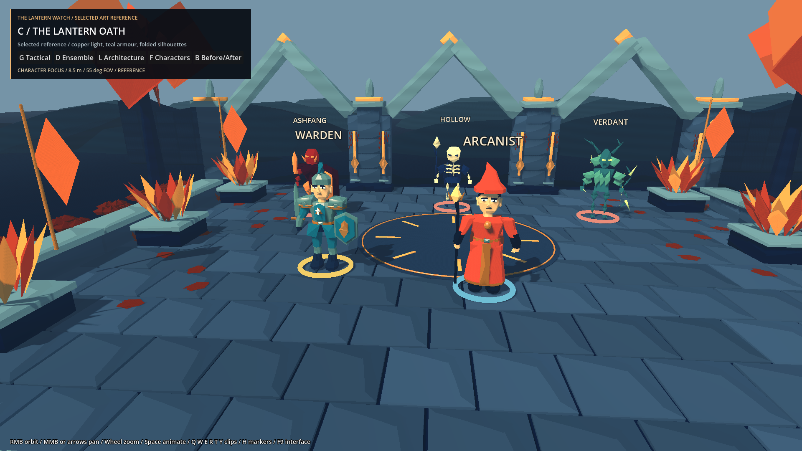

# C selected - The Lantern Oath reference

Option C was selected by the user. This pass refines that direction into an isolated representative reference scene; it does not roll the art out across the game.

## Open it

In the existing Godot project, open:

`C:\Users\Daniel.Flinders\Documents\Codex\2026-10-20\implement-the-first-milestone-of-a\outputs\FantasyTactics\dev\art_direction\reference_c.tscn`

Press **F6**. The original three-option comparison is still available separately. F5 and normal gameplay are unchanged.

- **B** or Before/After: toggle original C and refined C, preserving the camera and actor placements.
- **G**: tactical overview; **D**: ensemble/material view; **L**: architecture; **F**: closer character view.
- **Space**: animate/freeze. **Q/W/E/R/T/Y**: Idle/Walk/Attack/Cast/Hit/Death.
- **H**: markers; **F9**: interface. Existing RMB orbit, MMB/arrows pan and wheel zoom remain available.

The first three presets retain the original comparison cameras. The new character view is a perspective camera at 8.5 m, -0.30 rad pitch, 0.08 rad yaw, 55-degree FOV, focused at (-1.2, 1.05, 1.7). Before/After uses exactly the same camera and frozen pose.

## What was refined

- Retained C's blue stone, copper vegetation, chevron arches, faceted surfaces and light bands.
- Lifted shaded Warden armour and Verdant bark/leaf values so they separate from the ground. Warden steel is `#A0D3D3`, cloth `#378B9B`; Verdant bark `#4B8589` and leaves `#77B5A0`.
- Added restrained cool non-shadow-casting fill, with copper key light `#FFD0A1`, cool ambient `#A2BAD0`, and a small material-edge lift on actors. This is a cheap surface treatment rather than a screen-space outline effect.
- Added narrow copper architectural inlays and repeated Watch lantern reliefs. A raised lantern badge links the Warden shield to the architecture.
- Reduced environmental material noise and retained broad, intentional shading bands. No volumetric effects, GI, bloom, new image textures or renderer changes.
- Improved lab labels and provided a direct character-focus view and live Before/After comparison.

The fixed five actors, positions, shared rigs, six clips, selection rings and underlying courtyard layout are retained. No combat values, controls or navigation geometry were changed.

## Visual evidence

[Before/After sheet](before-after.png): original C on the left, refined reference on the right; ensemble view above, character view below.

| View | Refined C | Original C baseline |
| --- | --- | --- |
| Gameplay, 1920 x 1080 | [Reference](reference-gameplay.png) | [Baseline](baseline-gameplay.png) |
| Ensemble, 1920 x 1080 | [Reference](reference-ensemble.png) | [Baseline](baseline-ensemble.png) |
| Architecture, 1920 x 1080 | [Reference](reference-architecture.png) | [Baseline](baseline-architecture.png) |
| Characters, 1920 x 1080 | [Reference](reference-characters.png) | [Baseline](baseline-characters.png) |
| Gameplay, 1280 x 720 | [Reference](reference-gameplay-720p.png) | Original comparison evidence retained separately |

All screenshots come from Godot's actual Compatibility renderer. The contact sheet only resizes and assembles those images.

## Validation and limits

Godot 4.7.2 standard / OpenGL Compatibility, NVIDIA RTX 500 Ada Generation Laptop GPU. `reference_tests.gd` reports **C REFERENCE RESULT: 0 failures**. Checks cover the selected default, four camera views, repeated Before/After switching, fixed positions, five actors, and recovery through all six animation clips. Rendered capture completed without missing assets or shader-compilation errors. Gameplay-distance and character screenshots were inspected.

The original external project path was visible to file tools but rejected by the native Godot process under this turn's narrowed filesystem access. Validation and captures therefore ran against a complete local copy of the project with identical reference source files. The deliverable source is saved in the original project. No claim is made that the original path was successfully launched in this turn.

The original low-poly faces, rigid clothing, simplified anatomy and short animations remain. This reference sets the visual treatment; it is not a full character resculpt or a rollout to all maps. No new performance certification or full-game regression run was needed for these isolated files. The previous exploration report retains the wider project's known stale flow assertion and shutdown-warning findings.

## Added files and revert

All additions are inside the already excluded `dev/art_direction` folder:

- `reference_c.tscn`: selected reference entry.
- `reference_c.gd`: C-specific material, lighting, motif, controls and focus-view refinements; extends the original comparison.
- `reference_surface.gdshader`: refined C material response.
- `reference_tests.gd`: reference invariants and animation checks.
- `reference_capture.gd`: matched Before/After capture script.
- `REFERENCE_C.md` and `selected_c_evidence/`: notes and real renderer screenshots.

The three-way comparison, its shader and geometry helpers were not edited. The existing development-folder export exclusion also covers the new reference files.

To revert only this pass, remove the five `reference_*` source files and their generated `.uid` companions, `REFERENCE_C.md`, and `selected_c_evidence`. Keep the original comparison folder contents. No production asset, gameplay script, settings file or save needs restoring.

This completes the selected-reference pass for Milestone 1. Environment-wide lighting, assets and material rollout belong to later milestones and have not been started.
