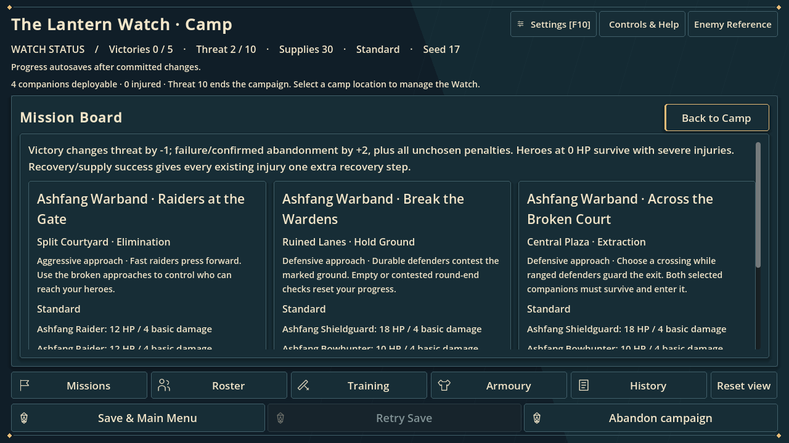
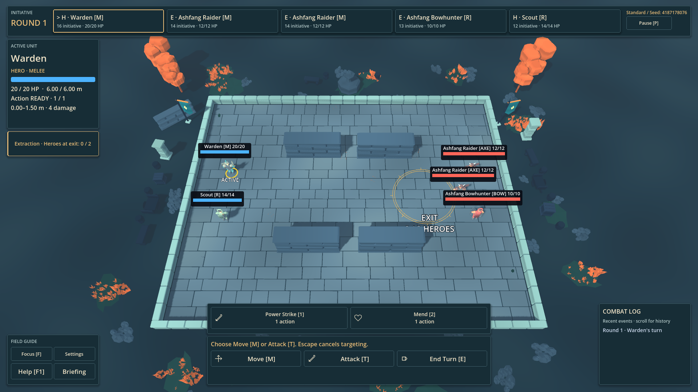
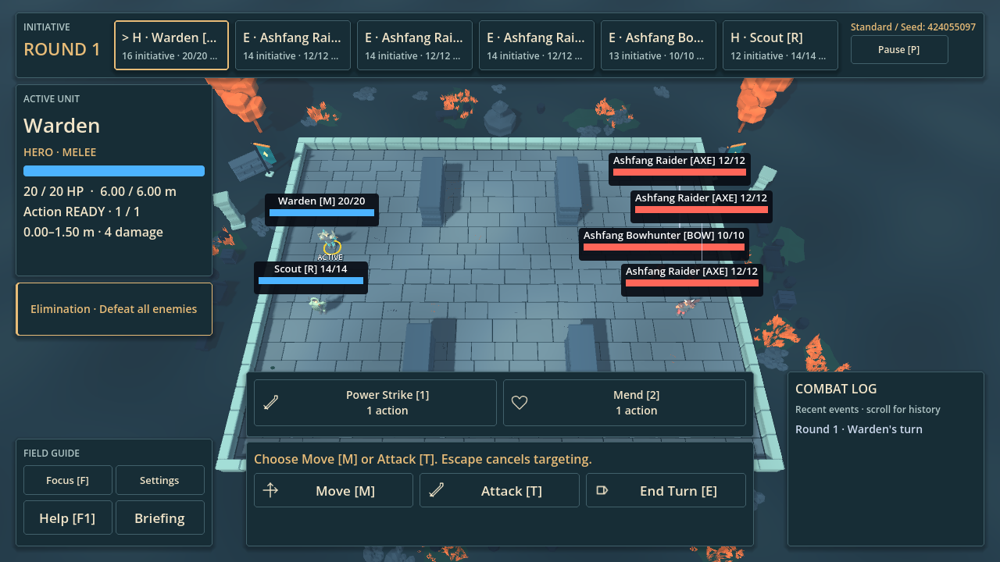

# Milestone 3 — Mission Variety Report

28 October 2026 · `C:/Temp/FantasyTactics` · Godot 4.7.2 standard · typed GDScript

## Scope and audit

The project already contained free-navigation combat, four selectable heroes, three enemy factions and their elites, Elimination/Hold Ground/Extraction, three ruined-courtyard presets, difficulty budgets, five-victory campaigns, recovery offers, frozen encounter codes, and between-mission persistence. Milestone 2's tactical planner and its command/cancellation boundaries were retained.

Repetition came from fixed objective rotation, only two faction roster orderings, three layout topologies, and generic faction text repeated on every board card. This milestone adds authored mission constraints and distinct compositions without changing damage, health, action limits, difficulty multipliers, campaign rewards, injuries, or threat calculations.

**Final status:** implemented and ready for review. The full batch passed 71/73 suites initially. The genuine-legacy fixture correction and a measured lifecycle batch-budget adjustment have passing focused followups; all 73 suites therefore have passing evidence across the batch and followups. A second clean all-suite batch after those test-only changes was not run. Production source hashes stayed unchanged throughout final verification. Original failures/interrupted runs remain preserved.

## Implemented content

Nine editable `.tres` templates live in `definitions/missions/`:

| Template ID | Player-facing name | Objective | Composition |
|---|---|---|---|
| `raiding_party` | Raiders at the Gate | Elimination | Mobile melee pressure, ranged support |
| `bowline` | Silence the Bowline | Elimination | Protective frontline, multiple archers where budget permits |
| `courtyard_watch` | The Lantern Watch | Hold Ground | Mixed mobile/ranged/support patrol |
| `lantern_defence` | Break the Wardens | Hold Ground | Durable frontline and useful support |
| `homeward_passage` | The Homeward Passage | Extraction | Mobile interceptors and shooters |
| `split_extraction` | Across the Broken Court | Extraction | Frontline and ranged defenders |
| `herbwardens` | Gather the Herbwardens | Elimination | Existing recovery/supply alternative |
| `elite_hunt` | The Warning Bell | Elimination | Existing elite with bounded escorts |
| `last_beacon` | The Last Beacon | Elimination | Existing harder campaign finale |

Templates contain stable ID/version, name/briefing, objective, allowed layouts/factions, style, ordered role slots, introduction bounds, and recovery/elite/finale flags. Rewards derive from existing campaign rules rather than a second reward calculator. Validation rejects unknown references, roles/objectives, malformed constraints and unsupported versions.

The catalog fills at most four regular slots within the existing faction/difficulty budget, or the existing elite plus at most two escorts. At most one healer is allowed. Frontline choices favor durability, mobile choices favor movement, and ranged slots use archers while caster slots remain separate. Introduction stages still apply. When a scarce role is unavailable, affordable legal existing roles may fill the minimum two-unit roster. Low budgets can therefore collapse nominally different templates to similar compositions; the report does not equate nine templates with nine distinct tactics on every difficulty.

## Battlefield arrangements

The original indexes and generator-version-2 branches remain intact. Two presets append at indexes 3 and 4 and are available in normal Skirmish setup:

| Preset | Tactical arrangement |
|---|---|
| Open Courtyard | Existing scattered blockers and broad routes |
| Ruined Lanes | Existing broken-wall lanes |
| Central Plaza | Existing central objective composition |
| **Narrow Approach** | Horizontal ruined masonry funnels north/south approaches; the center and perimeter bypasses remain connected |
| **Split Courtyard** | Vertical wall groups form side pockets and separate crossings, with a broad clear center |

Both new presets reuse existing wall meshes, collision, materials, ground and dressing. They introduce no asset dependency, elevation, terrain rules, or extra rendering system. Blocking geometry precedes navigation baking. Cosmetic density uses the existing separate deterministic stream and does not change spawns, objectives or gameplay blockers. Canonical bounded fallback layouts preserve the selected preset.

## Objectives and AI

The implementation deliberately retains three complete objectives:

- **Elimination:** all enemies defeated; no heroes means defeat; simultaneous elimination by one atomic action is a draw.
- **Hold Ground:** three consecutive controlled round-end checks, with a living hero inside and no living enemy inside. Empty/contested checks reset progress. Killing every enemy does not automatically win.
- **Extraction:** both originally selected heroes alive and inside the exit after a completed action. Either required hero dying makes extraction a defeat after atomic resolution. Enemies dying does not replace the exit requirement.

Existing objective-aware AI continues to contest ground and intercept extraction routes through the same bounded planner and commands. No combat-rule or AI-scoring rewrite was needed. Protect-target, survival and reinforcement objectives were not added: three objectives already exist, while those options need additional actor/timing/spawn infrastructure and would expand the milestone beyond mission composition and arrangements.

## Campaign, replay and compatibility

New boards still have three offers, or one finale. They prefer distinct compatible layouts and avoid immediately repeating the last completed template when a compatible alternative exists. Existing faction introduction by campaign victories, occasional recovery offers, elite opportunities and final challenge remain. Board and preparation cards now show the frozen mission briefing and approach alongside actual adjusted enemy stats, objective, rewards and risks.

New offers freeze template metadata plus the complete resolved encounter code. Loading never chooses a new template or rerolls a roster. Existing offers without template metadata remain accepted. The v1 campaign fingerprint deliberately continues to cover the original three presets; adding catalog entries does not invalidate shipped saves. Unsupported/malformed template metadata is rejected with a readable message without changing active state or overwriting a save. Existing interrupted-mission policy restarts the same committed deployment, not a mid-combat save.

A regression exposed `PartySelection.configuration()` replacing a valid imported purposeful roster with the default faction roster. It now preserves the frozen roster when the imported seed/objective/difficulty remain selected, and the setup preview agrees. Explicitly changing seed/objective/difficulty requests a new standard variation. Retry uses the same frozen setup. Campaign free retry/reroll remains disabled. Configuration reproduction does not imply a recorded-action replay or sharing campaign upgrades through a skirmish code.

A review also caught an incorrect String property assignment in the new malformed-metadata error branch. Parsing and a readable-error regression protect its correction. The failing/interrupted logs are retained.

## Verification and variety measurements

### Before/after variety

Both structural samples inspect 20 campaign seeds 17–36, each over five successful mission resolutions, with the existing three difficulties: 260 offers per sample. The archived baseline predates tactical-AI work, but its mission-generation rules/budgets are the pre-template system; this comparison does not run AI.

| Measure | Before | After |
|---|---:|---:|
| Battlefield arrangements represented | 3 | 5 |
| Objective types | 3 | 3 |
| Distinct enemy unit multisets | 14 | 26 |
| Distinct mechanical combinations | 116 | 136 |
| Named authored templates | none | 9 |

A mechanical combination is **layout + objective + faction + difficulty + sorted roster**. It deliberately excludes template names, seeds, and roster ordering. The sample therefore shows about 17% more distinct mechanical combinations and 86% more unit compositions, rather than claiming a ninefold increase from nine names. Counting template identity and ordered rosters gives 143 combinations; that broader number is not the primary tactical-variety metric. All 260 current offers were structurally valid and their prepared codes matched their frozen offer codes.

Objective frequency remains 120 Elimination, 80 Hold Ground, 60 Extraction. Layout frequency:

| Layout | Offers |
|---|---:|
| Open Courtyard | 58 |
| Ruined Lanes | 44 |
| Central Plaza | 55 |
| Narrow Approach | 39 |
| Split Courtyard | 64 |

All nine templates appeared. Recovery and final missions retain their existing objective/reward roles, so the sample is intentionally not evenly distributed. Frozen configuration examples, with complete importable encounter codes, are in [mission-examples.json](mission-variety/mission-examples.json). A seed alone is insufficient: difficulty, preset, objective, roster/configuration version and definitions also matter.

### Automated checks actually executed

| Check | Observed result |
|---|---|
| Pre-change baseline | 6/6 objective, campaign, persistence, compatibility and tactical suites passed |
| Template/composition matrix | 342 legal, deterministic faction/difficulty/stage cases passed; invalid definitions and malformed/future metadata rejected |
| New layout matrix | 60 fixed-seed cases and 66 real bakes including fallbacks; 2–4 enemies; spawn clearance, objective travel, alternate routes, density invariance and exact repetition passed |
| All preset/objective generation | 150 cases passed |
| All preset/objective/difficulty generation | 225 cases and all six hero-pair initializations passed |
| Fresh campaign-offer combat simulation | 45/45 completed;933 turns;2,264 commands;zero rejected commands and assertions |
| Objective outcomes in those matches | Elimination 7 victories / 17 defeats; Hold 2 / 10; Extraction 3 / 6 |
| Complete campaign regression | Command-driven Easy campaign reached five victories and campaign victory; progression/equipment/debrief exercised |
| Source full regression | 71/73 strict passes initially; see corrections below |
| Focused integrity followup | Genuine v1 fixture, writes/backup/failure checks passed, 63.65 s |
| Focused lifecycle diagnostic | All 12 cycles passed,203.51 s;300 s normal batch budget now configured |
| Packed-resource production smoke | Four phases passed both normally and from outside the project: title/tutorial/skirmish, campaign/equipment/settings, interrupted mission recovery, completed encounter/debrief and duplicate-reward protection |

The 45 matches include every template, all five layouts, all three factions/objectives/difficulties and all six hero pairs. This is not every Cartesian combination. There were 12 hero victories and 33 defeats. Stage fixtures advance XP but leave upgrade choices unspent and default equipment in place; these win rates are not player-balance evidence. Naturally resolved tactical outcomes and artificial campaign-stage transitions are distinguished in the simulation tool.

The initial full-run failures were not hidden:

1. `save_integrity_tests` fabricated a legacy offer by stripping faction fields from a newly generated offer while leaving new template metadata. It now uses the actual checked-in v1 save, retaining the freeze/write/failure/recovery assertions. The corrected suite passed separately.
2. `session_lifecycle_tests` exceeded 180 s after eight generated battlefields, with no assertion failures. An instrumented bounded diagnostic completed all 12 cycles in 203.51 s. The normal runner now allows 300 s for this finite batch. Movement, AI, action and combat frame/turn watchdogs were not increased. The diagnostic's outer bound was 450 s; it exited naturally well below 300 s.

No gameplay-source changes were made after the final full run began. Only those two test scripts and the runner budget changed. The runner was parsed again; the whole 73-suite batch was not repeated after these test-only corrections. The earlier interrupted focused run (including a parser mistake corrected during development), the 180 s structural-inspection timeout and the paused 24-case simulation prefix are retained and are not counted as successful final runs.

### Reproduction examples

| Campaign seed / difficulty | Mission seed | Template | Layout | Faction |
|---|---:|---|---|---|
| 17 / easy | 424055097 | `raiding_party` | split_courtyard | ashfang |
| 17 / easy | 1504445678 | `lantern_defence` | ruined_lanes | ashfang |
| 17 / easy | 3259987469 | `split_extraction` | central_plaza | ashfang |
| 17 / easy | 4159052064 | `courtyard_watch` | central_plaza | hollow |
| 17 / easy | 1042572466 | `homeward_passage` | narrow_approach | hollow |
| 17 / easy | 4209980631 | `herbwardens` | split_courtyard | hollow |
| 17 / easy | 3313750695 | `elite_hunt` | ruined_lanes | verdant |
| 17 / easy | 1367464728 | `last_beacon` | central_plaza | hollow |
| 18 / standard | 401159621 | `bowline` | open_courtyard | ashfang |

### Rendered inspection

Actual Compatibility-renderer captures were produced on NVIDIA RTX 500 Ada Generation Laptop GPU / OpenGL 3.3. The game loaded the campaign board and both new battlefield arrangements at 1280×720 and 1920×1080, with clean showcase exits. Images were inspected for the mission text, objective markers, visible blockers and HUD placement. This is rendered screen inspection, not a human-completed encounter or an input/accessibility certification.

At 720p the mission board intentionally scrolls vertically to reach all card details/actions; at 1080p the shown board fits without that scroll. The existing six-unit initiative bar truncates some long labels at 720p, and the existing lower HUD occupies appreciable battlefield space. These presentation limitations were not turned into a UI redesign.





All six original-resolution captures are in `docs/mission-variety/screenshots/`. No concept images or external assets were substituted.

### Performance and limits

Generation inspection records time and distributions, while navigation and simulation reports record actual successful configurations and query bounds. Repeated template definition/reference work was reduced using a scene-owned definition cache and catalog ID checks; the inspector avoids needlessly materializing each preview twice. These changes do not alter gameplay RNG or frozen code semantics. The initial 260-offer inspection exceeded its 180-second routine limit; a bounded extended run, distinct from the quick five-campaign suite, is retained. No failed run is silently relabeled as passing.

CPU batch times include resource/schema validation and private-file I/O under the test environment. They are not player loading times, a GPU frame-rate benchmark, or proof of universal performance. No new frame-time budget is claimed.

Measured inspection time was 214.93 s for the baseline 260 offers and 261.22 s for the current 260 offers (263.73 s including process startup/exit). This workload includes campaign-stage fixtures and frozen-code validation, not just obstacle placement. It is slower, and the baseline also predates M2 profile metadata, so the difference is not a controlled attribution to mission templates alone. The 45-match batch took 415.55 s. Its largest accumulated planner decision was 1,443.5 ms and largest observed turn 3,436.3 ms, measured under the headless workload across bounded planning chunks; a quiet in-game frame profile is still needed.

The 12-cycle diagnostic held 242 nodes, 2,443–2,444 objects and 190→191 resources (then stable). Static memory was 57,697,522→58,156,042 bytes, about 0.44 MiB growth over this finite sample. Median complete cycle time was 16.41 s, creation/checkpoint 3.03 s, navigation/setup 2.95 s and isolated encode/decode 0.66 s. Those measurements explain why the 180 s batch budget was insufficient; they do not prove absence of leaks over arbitrary durations.

Human balance/playtesting of every party/template combination remains outstanding; automated losses do not establish that a mission is impossible.

## Reproduction and authoring

From the project root, with the Godot 4.7.2 console executable assigned to `$Godot`:

```powershell
./tests/run_regressions.ps1 -Godot $Godot -Category mission -TimeoutSeconds 180
./tests/run_regressions.ps1 -Godot $Godot -Category all -TimeoutSeconds 180
& $Godot --headless --fixed-fps 60 --path . --script res://dev/mission_inspector.gd -- --campaigns=20 --seed=17 --report-root=C:/Temp/FantasyTactics/verification/mission-inspection
& $Godot --headless --fixed-fps 60 --path . --script res://tests/mission_simulation_tests.gd -- --encounters=45 --report=mission-simulations.json --report-root=C:/Temp/FantasyTactics/verification/mission-play
```

The inspector produces plain JSON with template/version, campaign/mission seeds, generator, layout, faction, roster, objective, difficulty, rewards and shareable encounter codes. It uses real campaign offer/preparation/result logic; its stage-progression outcomes are fixtures, not naturally played victories. Mission simulations use the real tactical commands and shared planner for both factions, with accelerated fixture presentation only. Normal heroes remain player controlled. Test data stays under isolated test paths, never the active player campaign slot.

For content authoring, duplicate an existing `.tres`, assign a unique ID, register it in `MissionCatalog.IDS`, edit compatible layouts/factions and bounded role slots, then run template validation and the inspector. No CombatController changes or graphical editor are required. Restart to load modified definitions; existing frozen offers retain their old configuration. Deliberate schema changes need a new supported version and compatibility handling.

## Important files

- `scripts/mission_template.gd`, `mission_catalog.gd`; nine resources in `definitions/missions/`.
- `battlefield_generator.gd`, `encounter_options.gd`, `encounter_configuration.gd`; two resources in `definitions/presets/`.
- `campaign_state.gd`, `campaign_save_codec.gd`, `campaign_screen.gd`: frozen offers, optional compatible metadata and briefings.
- `party_selection.gd`, `menu_screen.gd`: imported roster preservation and correct setup previews.
- `tests/mission_*_tests.gd`, the small AI-simulation configuration hook, expanded existing generation matrix counts, regression runner.
- `dev/mission_inspector.gd`, `mission_showcase.gd`, this report and renderer captures.

Earlier uncommitted Milestone 2 changes are preserved and are not attributed to Milestone 3. No commits, campaign rebalancing or Milestone 4 work are included.

## Remaining issues / review gate

1. **Release verification:** a new native Windows EXE was not exported because the configured matching release template (`../../work/export-templates/windows_release_x86_64.exe`) is absent. The 7,041,288-byte resource pack was tested through the standard engine, including an external working directory; this is not standalone-EXE verification. Earlier M2 native shutdown faults were not reproduced here, but their root cause was not established.
2. **Regression accounting:** all 73 suites have passing evidence after focused followups, but a single clean full batch after the fixture/budget changes remains unperformed. Preserve the original 71/73 result when reporting this work.
3. **Performance/balance:** quiet GPU profiling and human playtesting remain outstanding. Batch inspection is slower than the archived baseline. The automated match matrix is representative, not exhaustive, and does not establish that every party/template pairing is balanced.
4. **Content distribution:** faction introduction/rotation remains unchanged. Some early Ashfang/Hollow support roles are more available in skirmish/template scenarios than in the short campaign; later Verdant missions carry more support variety. Low budgets can collapse different named templates to similar rosters. No reinforcements, protected-target or survival system was added.
5. **Presentation:** 720p uses vertical scrolling for mission cards and truncates some six-unit initiative names. Both new layouts use the same art kit and four-wall budget; they are topology variations, not new themes. No major visual redesign was attempted.

Suggested human review: play each objective on both new presets; inspect a healer and elite composition; import an example code and retry it; close during a campaign deployment and continue; scroll and keyboard-focus the 720p board; use enlarged text/settings; confirm five-victory progression with your preferred party. No human-completed playtest is claimed.

The implementation is ready for review. Milestone 4 — Campaign Events and Character Identity — has not begun.
